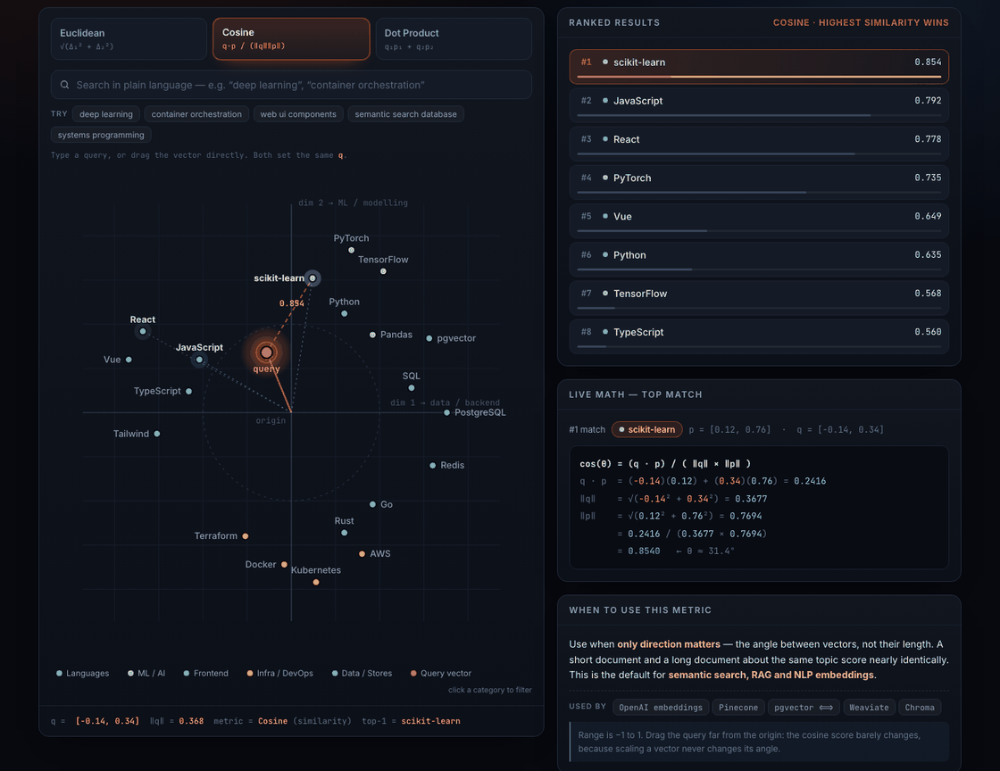

# Vector Search Metrics — How AI Finds "Similar" Things

An interactive, single-file visualization of the three distance metrics that power vector
databases and semantic search: **Euclidean**, **Cosine**, and **Dot Product**.

**[▶ Open the live demo](https://abhargav0021.github.io/vector-search-metrics/)**



---

## What it shows

Twenty tech skills are placed as points on a 2-D embedding plane, positioned so that semantic
neighbours really are neighbours — `Docker`/`Kubernetes`/`Terraform` cluster together, as do
`React`/`Vue`/`Tailwind` and `PyTorch`/`TensorFlow`/`scikit-learn`.

You can then:

- **Drag the orange query vector** anywhere on the plane, or tap/click to place it.
- **Search in plain language** — `"container orchestration"`, `"deep learning"`, `"caching"`.
  The text is embedded into a vector and the query animates to its new position.
- **Switch metrics** and watch the same query produce a *different* #1 result.
- **Filter by category** by clicking the legend, which acts as a metadata pre-filter.

The ranked top-8 re-sorts with sliding animations, and a live math panel substitutes the real
numbers into the active formula on every frame:

```
cos(θ) = (q · p) / ( ‖q‖ × ‖p‖ )
q · p  = (0.06)(0.14) + (-0.90)(-0.96) = 0.8724
‖q‖    = √(0.06² + -0.90²) = 0.9020
‖p‖    = √(0.14² + -0.96²) = 0.9702
       = 0.8724 / (0.9020 × 0.9702)
       = 0.9969   ← θ ≈ 4.5°
```

## The point

Same data, same query, three different answers:

| Query | Euclidean | Cosine | Dot Product |
|---|---|---|---|
| `[-0.14, 0.34]` | JavaScript | scikit-learn | React |

- **Euclidean** — magnitude matters. Used by FAISS L2, Milvus, KNN.
- **Cosine** — only direction matters. The default for semantic search and RAG.
  Used by OpenAI embeddings, Pinecone, pgvector, Weaviate.
- **Dot Product** — both matter, so popularity can be baked into vector length.
  Used by two-tower recommenders and MIPS indexes.

## How the search works

A query string is turned into a vector by averaging the vectors of the vocabulary terms it
contains — a toy bag-of-words encoder. Real models do the same job with a neural net in
768–3072 dimensions, but the downstream math is identical:

```js
embed("container orchestration")
  → matched ["container", "orchestration"]
  → q = [0.06, -0.90]
  → #1 Kubernetes (cosine 0.997)
```

## Running it

No build step, no dependencies, no server required:

```bash
open vector-search-demo.html
```

Everything is inline in one HTML file — vanilla JS and SVG. The only external resource is a
Google Fonts stylesheet, and it degrades to system fonts offline.

## Note on the embeddings

The 2-D vectors are hand-placed for intuition, not learned from a corpus. That is the whole
point: at two dimensions you can *see* why the metrics disagree, which is impossible to picture
at 1536 dimensions where this math actually runs.
